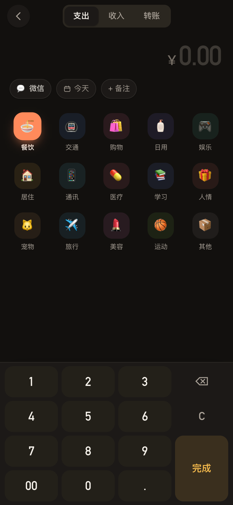
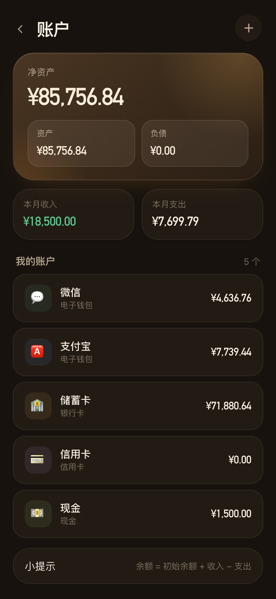
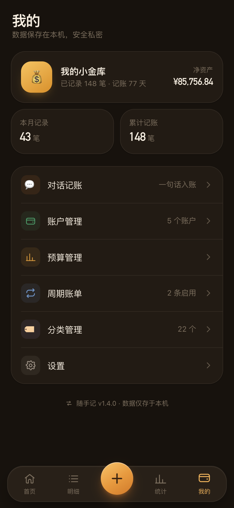
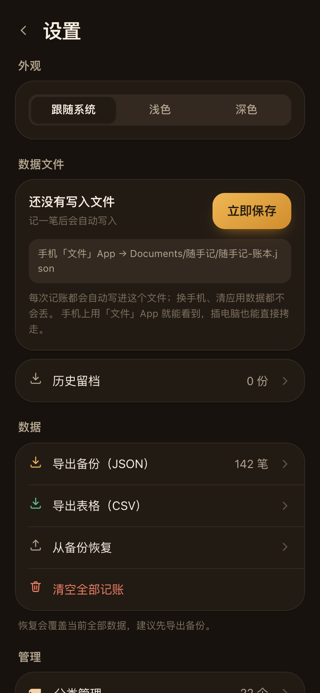
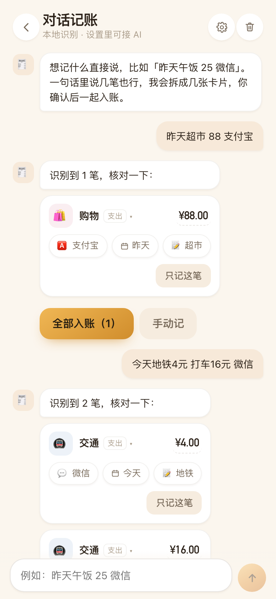
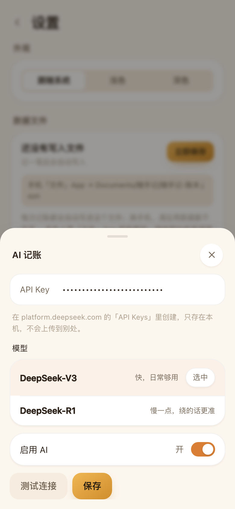
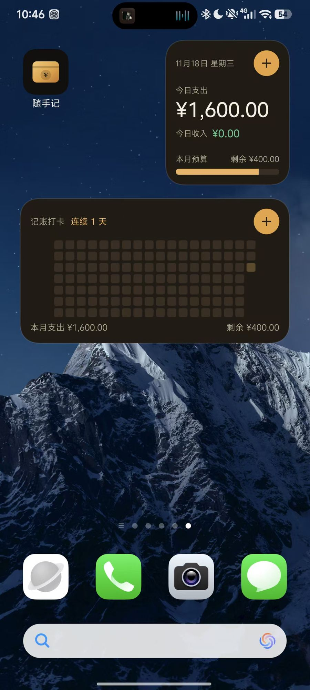

# 随手记 · 记账

一款给自己用的极简记账 App。**只有安卓 App 一种形态**，不注册、不上传，
默认也不联网——**打字或说话记一笔**，本地就能拆出金额、分类、账户。

账本不是存在浏览器缓存里，而是写成手机里一个真实的文件：
`Documents/随手记/随手记-账本.json`。卸载重装、清除应用数据、换手机，
只要这个文件还在，打开 App 就会自动读回来。

## 安装

已经打包好签名的安装包，两种拿法：

- **直接下载**：[最新 Release](https://github.com/nimingzhe-ding/MoneyAccount/releases/latest) 里的
  `suishouji-1.4.1.apk`，手机上点开就能装。
- **仓库里**：[`release/suishouji-1.4.1.apk`](release/suishouji-1.4.1.apk)，随代码一起在版本库中。

装的时候需要在系统里允许「安装未知来源应用」。首次打开会看到深色启动页 + 金色 ¥ 图标。

App 里点「设置 → 关于 → 版本」会检查更新：只读一次仓库里的 `package.json` 比版本号，
**不上传任何记账数据**，发现有新版会给出 Release 下载页入口。

自己重新构建：

```bash
npm install

# 一次性准备：装 Android SDK（platforms;android-34 + build-tools;34.0.0）与 JDK 17
export ANDROID_HOME=$HOME/Library/Android/sdk
export JAVA_HOME=$(/usr/libexec/java_home -v 17)

npm run android:release   # 产物在 android/app/build/outputs/apk/release/
npm run android:debug     # 调试包，可直接 adb install
```

> 签名密钥在 `android/app/moneyaccount.keystore`（密码 `moneyaccount`），
> `android/keystore.properties` 与密钥文件都已加入 `.gitignore`，不进版本库。
> 换机重装记得带上这两个文件，否则无法覆盖升级已有安装。

### 发新版本

版本号只写一次，改 `package.json` 里的 `version` 就行：

```bash
npm version patch      # 1.0.0 → 1.0.1（也可以用 minor / major，或手动改）
npm run android:release
```

`android:*` 脚本会先跑 `scripts/sync-version.mjs`，把 `version` 同步成安卓的
`versionName`，并按 `major*10000 + minor*100 + patch` 算出单调递增的 `versionCode`
（1.0.1 → 10001），否则安卓会拒绝覆盖安装。界面里显示的版本号也来自同一个值。

打完包再发个 Release，App 里的「检查更新」才有地方可下载：

```bash
git tag v1.4.1 && git push origin v1.4.1
gh release create v1.4.1 release/suishouji-1.4.1.apk --title "随手记 1.4.1"
```

## 数据存在哪

```
Documents/随手记/随手记-账本.json        主文件，每次记账 0.8 秒内自动写一次
Documents/随手记/archives/2026-11-18.json  按天留档，同一天覆盖
```

- 手机上用「文件」App 就能直接看到、复制、发到网盘。
- 插电脑（USB）也能当普通文件拷走。
- App 启动时先读这个文件，文件比内存里的数据新就以文件为准。

安卓 11 起，系统默认只让 App 访问「自己创建的」文件，一旦清除应用数据，
就失去了对旧文件的访问权——那样账本会读不回来。所以首次打开会请求
**「所有文件访问」**权限，在系统设置里开一次即可，之后一直有效。
不给也能用，只是文件会退回 App 私有目录，清数据就没了。

## 界面预览

| 首页 | 明细 | 统计 |
| --- | --- | --- |
|  |  |  |

| 记账 | 预算 | 账户 |
| --- | --- | --- |
|  |  |  |

| 周期账单 | 我的 | 设置 |
| --- | --- | --- |
|  |  |  |

| 对话记账 | AI 设置 |
| --- | --- |
|  |  |

| 桌面小组件（深色主题，2×2 今日 + 4×2 打卡） |
| --- |
|  |

## 功能

| 模块 | 你能做什么 |
| --- | --- |
| 两个入口 | 首页并排两个大按钮：「记一笔」自己填金额分类，「对话记账」说一句话就记上；下面一排是常用分类的快捷入口 |
| 对话记账 | 说一句「昨天午饭 25 微信」→ 自动拆出金额、分类、账户、日期，卡片核对后一起入账；一句话几笔也能拆，记错了可撤销 |
| 极速记账 | 数字键盘输金额 → 点分类图标 → 完成。可选账户、日期时间、备注 |
| 三种流向 | 支出 / 收入 / 转账（账户间转账不计入收支统计） |
| 多账户 | 微信、支付宝、储蓄卡、信用卡、现金，可增删改名改色；信用卡可设额度 |
| 预算 | 月度总预算 + 分类预算，进度条、超支提醒、日均可用 |
| 统计 | 本月结余、近 6 月收支趋势、记账打卡热力图、每日支出柱状、收支分类占比环形图 + 排行 |
| 明细 | 按月浏览，按收支类型/分类/账户/金额区间筛选，关键词搜索 |
| 周期账单 | 房租、订阅、还款设成规则，打开 App 自动补记到期条目 |
| 分类管理 | 22 个预置分类，可增删、换图标换颜色、调整顺序；记账页里长按分类就能改，末尾的「＋」直接新建 |
| 打卡热力图 | 近 19 周每天一格，按笔数或金额着深浅；点开看当天几笔花了多少，另有连续记账天数 |
| 外观 | 跟随系统 / 浅色 / 深色 |
| 数据文件 | 自动把账本写成手机里的 JSON 文件，按天留档，可回滚到任意一天 |
| 桌面小组件 | 2×2 卡片显示今日支出、今日收入、本月预算；4×2 卡片显示近四个月打卡热力图和本月预算，点加号直接进记账页 |
| 备份 | 导出 JSON 全量备份、导出 CSV 明细、从备份恢复、清空数据 |

## 设计上的取舍

- **金额用「分」存整数**，不用浮点，避免 0.1 + 0.2 的经典问题。
- **账户余额是算出来的**：`初始余额 + 收入 − 支出`，转账双边扣加。不做冗余余额字段，永远不会算错。
- **周期账单在启动时补记**，不依赖后台任务——WebView 壳里没法常驻后台。
- **图表手写 SVG**，不引图表库，包体小、样式可控。
- **无路由库**，一个 hash 路由 40 行搞定，刷新不 404。
- **桌面小组件不碰账本文件**：组件进程读不到 WebView 的 IndexedDB，也不该去解析整份 JSON。Web 层每次数据变化把几个数字写进 SharedPreferences，原生只负责渲染，金额依旧是「分」。热力图在原生侧直接画成 Bitmap，不往 RemoteViews 里塞上百个格子 View。

## 视觉设计

- **暖奶油底色 + 蜜桃渐变卡**：浅色是 `#fbf6ee` 的纸张感背景，首页主卡是一条从奶油到蜜桃的渐变，不用纯白也不用冷灰，看久了不刺眼。
- **深色是暖咖啡棕**而不是炭黑（`#17120d` 底 / `#221b14` 卡片），夜里记账不会像看代码一样冷。
- **阴影用暖棕透明度**（`rgba(96,66,40,…)`）而不是中性灰，卡片像浮在纸上而不是贴了个灰边。
- **悬浮胶囊底部导航**：不再贴满整条底边，留出边距做成圆角胶囊，中间按钮抬起，单手够得着。
- **分类色板统一降饱和**，15 个支出分类彼此拉开色相，环形图分得清又不打架；v1 用户升级时数据库会自动把这些颜色迁移过来，**自己改过的颜色不会被覆盖**。
- **数字用等宽字形 + 小数位降一级**：`¥9,801.20` 里整数大、小数小，扫一眼就能读到关键位。
- **负数带符号**：账户余额为负（比如刷了信用卡）时显示 `-¥300.00`，负号在货币符号前面，不会被四舍五入藏起来。
- **打卡热力图沿用同一个暖色相**，只用深浅区分疏密，不和分类色抢注意力；未来日期用虚线格，暗示「还没到」。

## 目录

```
src/
  db/         types.ts 数据模型（金额单位：分） · seed.ts 预置分类/账户 · index.ts Dexie 打开与迁移
  lib/        format.ts 金额日期格式化 · store.tsx 全局数据与主题 · router.tsx hash 路由 · recurring.ts 周期账单补记
              nlp.ts 本地中文记账解析（金额/分类/账户/日期/多笔，纯规则、不联网）
              ai.ts 可选的 DeepSeek 解析（自己填 Key 才启用，失败自动退回本地规则）
              native.ts Capacitor 桥接：状态栏、返回键、文件导出、外链、组件深链
              update.ts 检查更新（只读远端 package.json 的版本号）
              widget.ts 桌面小组件快照：算好今日收支与预算，交给原生插件
  components/ Icons 手写 SVG 图标 · TabBar 底部导航 · Sheet 底部抽屉 · TransactionRow 记账行 · Donut / TrendChart
              Heatmap 打卡热力图 · CategoryEditor 分类编辑面板（记账页与分类页共用）
  pages/      HomePage 首页 · ChatPage 对话记账 · AddPage 记账 · TransactionsPage 明细 · StatsPage 统计
              BudgetPage 预算 · AccountsPage 账户 · RecurringPage 周期账单
              CategoriesPage 分类 · MinePage 我的 · SettingsPage 设置
  styles/     global.css 全部样式（CSS 变量驱动的深浅色主题）
scripts/
  sync-version.mjs 把 package.json 的 version 同步到 android/app/build.gradle
android/      Capacitor 生成的安卓工程（图标、启动图、签名配置都在这里）
              app/src/main/java/…/MoneyWidgetProvider.java 2×2 今日组件 · HeatmapWidgetProvider.java 4×2 打卡组件
              app/src/main/java/…/WidgetPlugin.java 快照桥（写 SharedPreferences 并刷新组件）
```

## 技术栈

React 19 · TypeScript · Vite · Dexie（内存库）· dayjs · Capacitor 6（打包安卓）
可选：DeepSeek API（`deepseek-flash`，即 V4.1-Flash），不填 Key 完全不联网

## 对话记账

首页和「记一笔」并排的那个「💬 对话记账」大按钮，或从「我的 → 对话记账」进去，直接说人话：

```
午饭 25 微信
昨天超市 88 支付宝
今天地铁4元 打车16元 微信
从储蓄卡转 1000 到微信
```

它会拆成一张张卡片，每张都能点开改分类、改账户、改日期、改备注，核对完
「全部入账（N）」一次性写进账本，后悔了点「撤销」整批退回。

**默认是本地规则**：`src/lib/nlp.ts` 用正则 + 关键词匹配中文，认金额（`25`
`二十五块` `9块9` `¥30` `1.2万`）、认分类（`火锅`→餐饮、`打车`→交通）、认账户
（`微信` `支付宝` `储蓄卡` `信用卡` `现金`）、认时间（`昨晚` `上周三` `5月3日`
`下午3点`），一句话里说几笔就拆几笔。不联网、不发请求、零延迟。

### 想更聪明一点：接 DeepSeek（可选）

「设置 → AI 记账」里填自己的 API Key（在
[platform.deepseek.com](https://platform.deepseek.com/api_keys) 创建），
就能把「早上跟同事吃的那个牛肉面 28，刷的支付宝」这种绕的说法也认出来。

用的是 `deepseek-flash`（DeepSeek-V4.1-Flash），请求时关掉了思维链——
记账只要看懂一句话、输出一段 JSON，不需要推理，关掉之后响应从十几秒降到一两秒，
也省掉几千 token 的钱。

- **Key 只存在这台手机上**（写进本地数据库，不进备份文件、不上传）。
- **只发必要信息**：当月支出汇总、分类名、账户名、各账户余额——不发送单笔明细。
- **随时可关**：关掉开关或删掉 Key，立刻回到纯本地规则。
- **失败自动兜底**：网络不通、Key 过期、余额不足，都会用本地规则再解析一遍，
  并在气泡里说明原因，不会卡住不让记账。

## 数据安全

账本同时存在两处：**手机里的 JSON 文件**（长期）和 App 内的数据库（运行时）。
卸载 App 不会删掉那个文件，重装后自动读回来。

但还是建议偶尔在「设置 → 数据文件」点一下「立即保存」，并在换手机前
用「导出备份」存一份到网盘。「历史留档」里能按天回滚到之前的状态。
