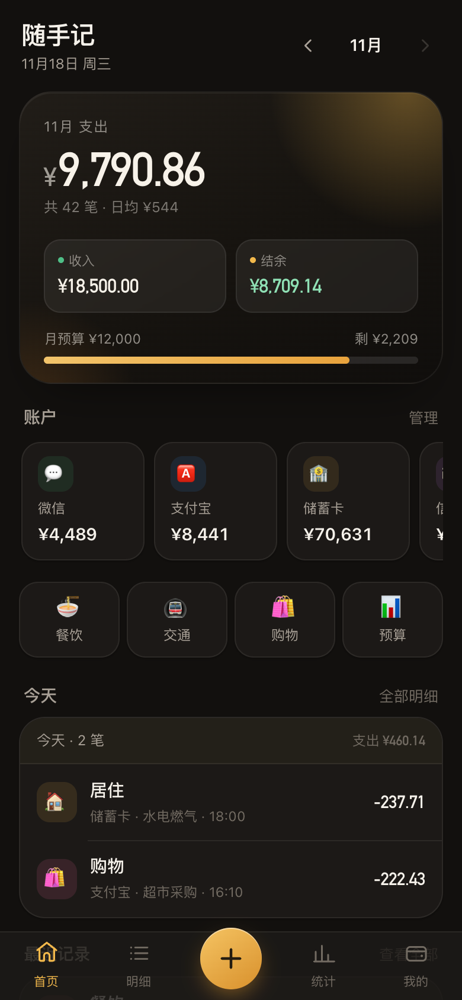
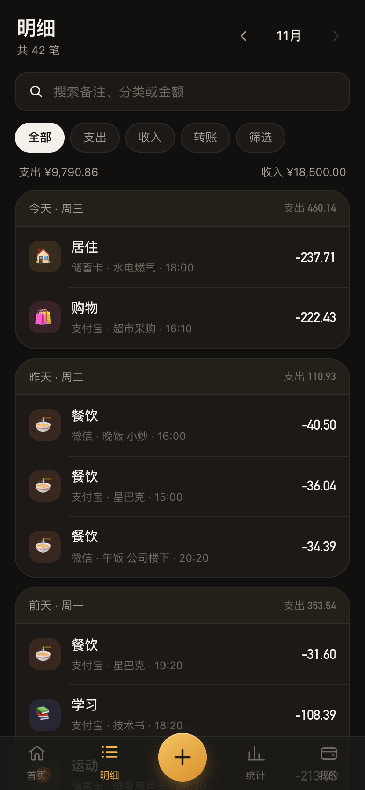
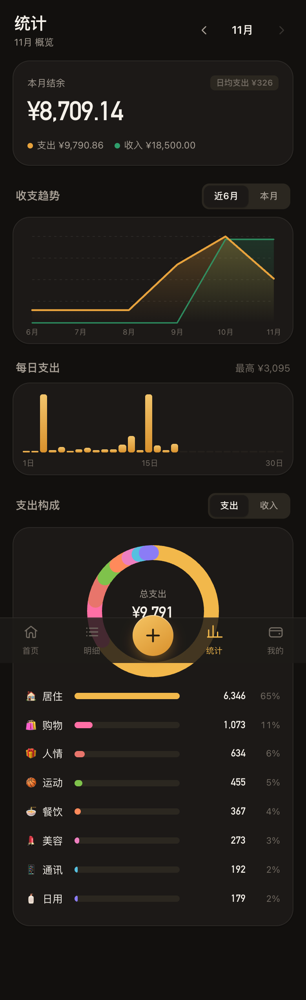
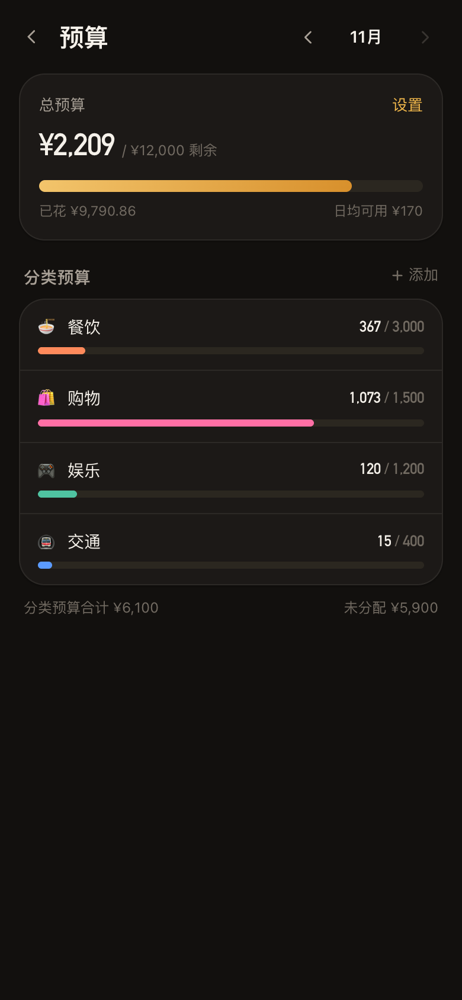

# 随手记 · 记账

一款给自己用的极简记账 App。数据全部留在本机（IndexedDB），不联网、不注册、不上传。
做成 PWA，可以「添加到主屏幕」像原生 App 一样全屏打开，断网也能用。

## 现在就能用

```bash
npm install
npm run build

# 手机和电脑连同一个 Wi-Fi，然后：
npm run serve:https
```

终端会打印形如 `https://192.168.x.x:5173` 的地址，用手机浏览器打开，
选择「继续访问」（自签证书提示），然后：

- **iPhone**：Safari → 分享 → 添加到主屏幕
- **Android**：Chrome → 菜单 → 安装应用 / 添加到主屏幕

桌面上会多一个金色 ¥ 图标，点开就是全屏 App，没有浏览器地址栏。

> 只想在电脑上看看：`npm run dev` 打开 http://localhost:5173 。
> 手机上如果只用 http 访问，功能一样正常，只是浏览器不允许注册 Service Worker，
> 因此没有「离线打开」；想离线必须 `npm run serve:https` 或部署到 HTTPS 站点。

## 界面预览

| 首页 | 明细 | 统计 |
| --- | --- | --- |
|  |  |  |

| 记账 | 预算 | 账户 |
| --- | --- | --- |
|  |  |  |

| 周期账单 | 我的 | 设置 |
| --- | --- | --- |
|  |  |  |

## 功能

| 模块 | 你能做什么 |
| --- | --- |
| 极速记账 | 数字键盘输金额 → 点分类图标 → 完成。可选账户、日期时间、备注 |
| 三种流向 | 支出 / 收入 / 转账（账户间转账不计入收支统计） |
| 多账户 | 微信、支付宝、储蓄卡、信用卡、现金，可增删改名改色；信用卡可设额度 |
| 预算 | 月度总预算 + 分类预算，进度条、超支提醒、日均可用 |
| 统计 | 本月结余、近 6 月收支趋势、每日支出柱状、支出/收入分类占比环形图 + 排行 |
| 明细 | 按月浏览，按收支类型/分类/账户/金额区间筛选，关键词搜索 |
| 周期账单 | 房租、订阅、还款设成规则，打开 App 自动补记到期条目 |
| 分类管理 | 22 个预置分类，可增删、换图标换颜色、调整顺序 |
| 外观 | 跟随系统 / 浅色 / 深色 |
| 备份 | 导出 JSON 全量备份、导出 CSV 明细、从备份恢复、清空数据 |

## 设计上的取舍

- **金额用「分」存整数**，不用浮点，避免 0.1 + 0.2 的经典问题。
- **账户余额是算出来的**：`初始余额 + 收入 − 支出`，转账双边扣加。不做冗余余额字段，永远不会算错。
- **周期账单在启动时补记**，不依赖后台任务——PWA 本来也没法常驻后台。
- **图表手写 SVG**，不引图表库，包体小、样式可控。
- **无路由库**，一个 hash 路由 40 行搞定，刷新不 404。

## 目录

```
src/
  db/         types.ts 数据模型（金额单位：分） · seed.ts 预置分类/账户 · index.ts Dexie 打开与迁移
  lib/        format.ts 金额日期格式化 · store.tsx 全局数据与主题 · router.tsx hash 路由 · recurring.ts 周期账单补记
  components/ Icons 手写 SVG 图标 · TabBar 底部导航 · Sheet 底部抽屉 · TransactionRow 记账行 · Donut / TrendChart
  pages/      HomePage 首页 · AddPage 记账 · TransactionsPage 明细 · StatsPage 统计
              BudgetPage 预算 · AccountsPage 账户 · RecurringPage 周期账单
              CategoriesPage 分类 · MinePage 我的 · SettingsPage 设置
  styles/     global.css 全部样式（CSS 变量驱动的深浅色主题）
scripts/
  serve.mjs   本地静态服务器，--https 时自动生成自签证书
```

## 技术栈

React 19 · TypeScript · Vite · Dexie（IndexedDB）· dayjs · vite-plugin-pwa

## 数据安全

数据只存在当前浏览器的 IndexedDB 里。**换手机、清缓存、卸载浏览器都会丢数据**，
所以请定期在「设置 → 导出备份」存一份 JSON 到网盘或电脑。
